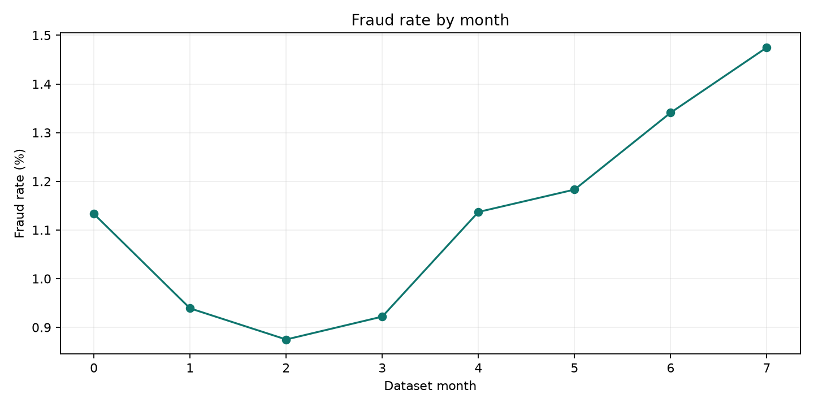

# Bank Account Fraud SQL Analytics

[](https://github.com/prhoguns/bank-account-fraud-sql-analytics/actions/workflows/ci.yml)

Eighteen questions about fraudulent **bank account applications**, answered with DuckDB SQL on the one-million-row Base variant of the [Feedzai Bank Account Fraud (BAF) dataset](https://github.com/feedzai/bank-account-fraud). The project adds a live Streamlit dashboard, reproducible result tables, and two static charts. The data is synthetic and labels describe the generated account applications.

**Headline:** reviewing the top 5% of applications finds 20.23% of labeled fraud and the top 10% finds 30.48%. The best single-feature rule (weak name/email match) finds 38.21% but queues 221,045 applications.

**Start with:** [Findings](FINDINGS.md) · [SQL questions](sql/) · [Results](results/) · [Dashboard screenshot](screenshots/dashboard.png)

CI runs all eighteen queries on every push against a small synthetic fixture with the real schema ([`scripts/make_fixture.py`](scripts/make_fixture.py)); the results in this repository come from the real data, downloaded locally.



## Run

```bash
python3 -m venv .venv
source .venv/bin/activate
pip install -r requirements.txt
python scripts/download.py
python scripts/build_db.py
python scripts/run.py
streamlit run dashboard.py
```

The downloader retrieves **Base.csv** from the authors' [Kaggle release](https://www.kaggle.com/datasets/sgpjesus/bank-account-fraud-dataset-neurips-2022). Kaggle may require account authentication in some environments. Raw data and the DuckDB file stay in `data/` and are excluded from Git. Query outputs and screenshots are committed so the analysis can be inspected without downloading data.

| Component | Details |
| --- | --- |
| Source | BAF Base variant, 1,000,000 synthetic applications; 11,029 labeled fraud |
| Engine | DuckDB 1.x |
| SQL | 18 independent questions in `sql/` |
| Outputs | CSV and Markdown in `results/`, PNG charts in `charts/` |
| Dashboard | Streamlit + Plotly, month and source filters |

## Questions

The SQL covers monthly trend and rate change; source, device, foreign-request, email, age, and income segments; name/email similarity and session-length gradients; application velocity; device email reuse; credit risk; transparent review rules; review capacity; drift; sentinel-value quality; and employment-segment reporting. Each query begins with its plain-language question.

## Interpretation

This is descriptive analytics, not a deployed fraud model. The review-budget ranking uses the dataset's `credit_risk_score` and name/email similarity, while the rule comparison uses simple declared thresholds. No causal claim follows from segment differences. The month field is an index from 0 to 7, not a real calendar month. Income is a normalized value in this release.

## Source and license

BAF was introduced by Sérgio Jesus and colleagues in *Turning the Tables: Biased, Imbalanced, Dynamic Tabular Datasets for ML Evaluation* (NeurIPS 2022). The source dataset is [CC BY-NC-SA 4.0](https://www.kaggle.com/datasets/sgpjesus/bank-account-fraud-dataset-neurips-2022); this repository does not redistribute it. Original project code is MIT licensed; see [LICENSE](LICENSE).
